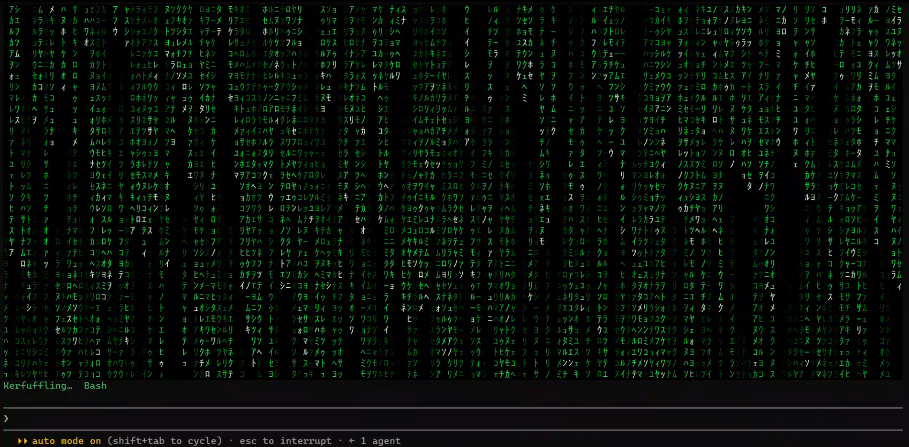
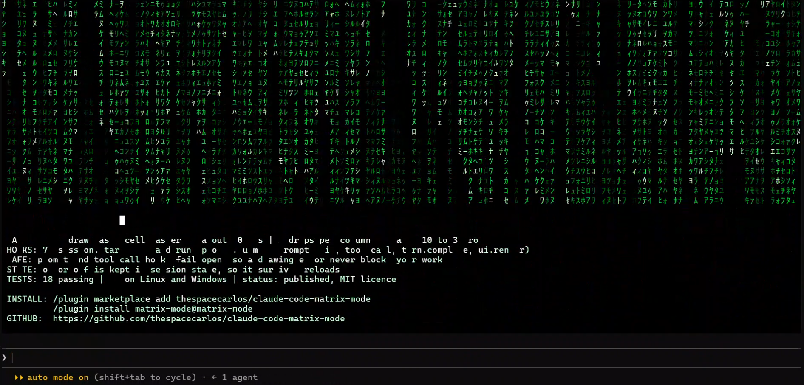
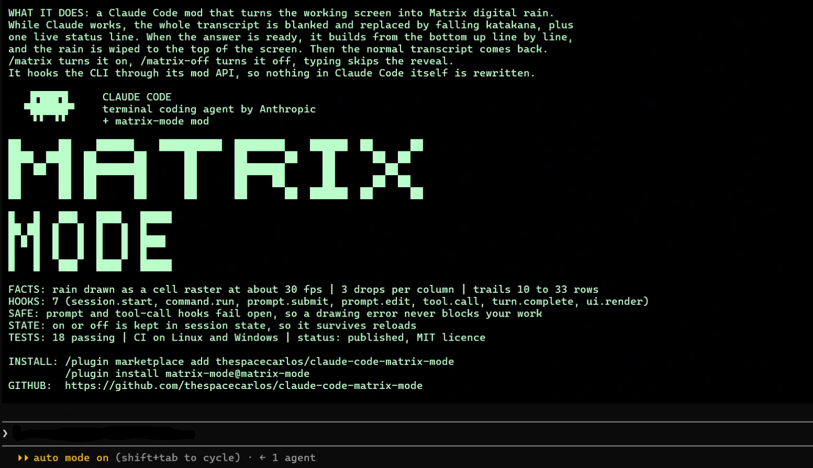

# claude-code-matrix-mode

Matrix digital rain for Claude Code. While Claude works, the transcript is replaced by falling rain; when the turn ends, the answer builds up out of it.







## Install

```
/plugin marketplace add thespacecarlos/claude-code-matrix-mode
/plugin install matrix-mode@matrix-mode
```

Restart Claude Code afterwards.

## Usage

- `/matrix` — turn matrix mode on
- `/matrix-off` — turn it off

While a turn runs, a short live line under the rain names the tool Claude is using. Esc skips the reveal and shows the full answer; typing or sending a prompt also ends it.

## Requirements

- Claude Code with plugin mods support. Tested only on 2.1.302 (Windows 11); other versions and platforms are untested.
- A terminal that renders colour. The rain is drawn as a raster, so it works best full-screen.

## Limitations

- The transcript is blank while a turn runs, by design. Turn the mode off with `/matrix-off` if you need to follow tool output live.
- The reveal only draws what a terminal cell can hold: Latin (including Polish), and box drawing pass through; emoji and CJK are shown as `?`.
- A very long answer reveals only its last screenful. Nothing is lost: switch the mode off and the transcript is back.
- Matrix mode is remembered across restarts. If you do not see the rain after an update, run `/matrix` again.

## Privacy and permissions

The plugin is cosmetic and local. It makes no network requests, starts no processes, reads no files and no environment variables. It stores one flag (`matrix-mode.isOn`) in Claude Code's plugin state.

It does hook broadly, because it replaces the look of the transcript: it listens to `prompt.submit`, `prompt.edit`, `tool.call` and `turn.complete`, and redraws the user message, assistant message, tool, spinner and notice components. It only reads the text of the final answer to draw the reveal. The `prompt.submit` and `tool.call` hooks fail open: if drawing fails, your prompt and the tool call still go through.

### What each hook does

- `session.start`: registers the `/matrix` and `/matrix-off` commands and closes the sidebar pane left over from v0.1.
- `command.run` (`matrix`, `matrix-off`): the commands themselves. They flip the on/off flag and answer with a one-line message; they do not pass the command on to anything else.
- `prompt.submit`: when a prompt is sent and the mode is on, starts the rain timer. The prompt is passed on unchanged.
- `prompt.edit`: typing ends a running reveal.
- `tool.call`: remembers the tool name for the live line. The tool call is passed on unchanged.
- `turn.complete`: when the answer arrives, starts the reveal. The answer is passed on unchanged.
- `ui.render`: draws empty boxes in place of transcript components (user and assistant messages, tool rows, notices, spinner) while a turn runs, and paints the rain and the reveal.

## Troubleshooting

- **No rain after `/matrix`:** restart Claude Code once after installing. Check `/plugin` that `matrix-mode` is enabled.
- **Screen stays blank:** run `/matrix-off`. Please open an issue with your Claude Code version and terminal.
- **Rain looks cut off:** enlarge the window; very small windows clip the animation.

## Development

```
claude plugin validate .
claude plugin test .
```

See [CONTRIBUTING.md](CONTRIBUTING.md), [SECURITY.md](SECURITY.md) and [CHANGELOG.md](CHANGELOG.md).

## License

[MIT](LICENSE) © Karol Krajewski
