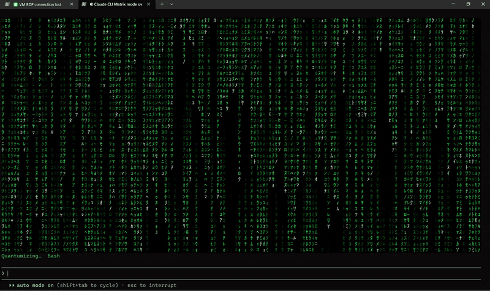

# claude-code-matrix-mode

Matrix digital rain for Claude Code. While Claude works, the transcript is replaced by falling rain; when the turn ends, the answer builds up out of it.



## Install

```
/plugin marketplace add thespacecarlos/claude-code-matrix-mode
/plugin install matrix-mode@matrix-mode
```

Restart Claude Code afterwards.

## Usage

- `/matrix` — turn matrix mode on
- `/matrix-off` — turn it off

## Development

```
claude plugin validate .
claude plugin test .
```

See [CHANGELOG.md](CHANGELOG.md).

## License

[MIT](LICENSE) © Karol Krajewski
